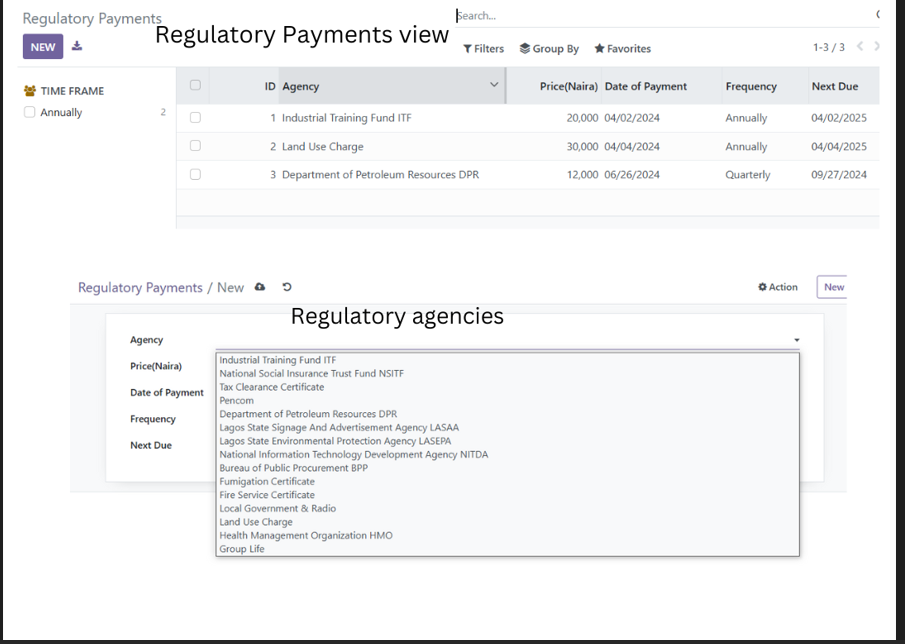
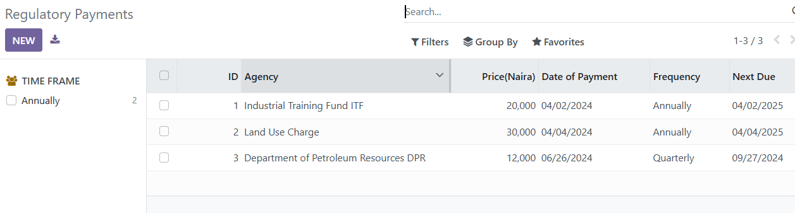
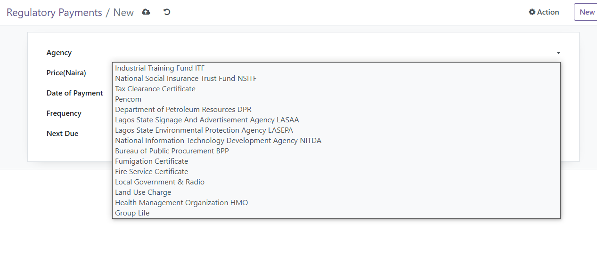
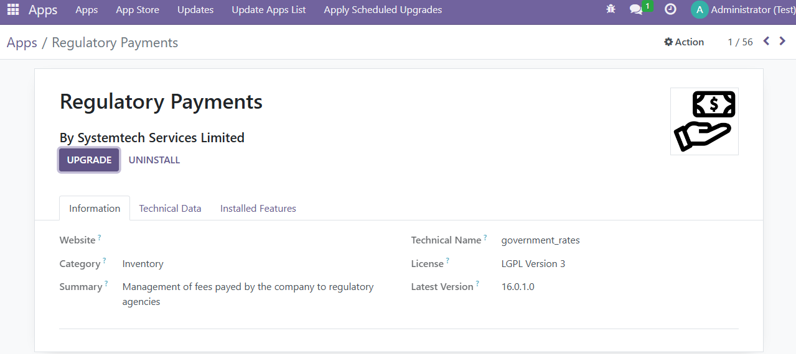
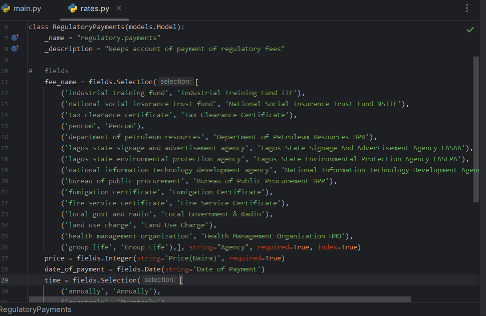

# Regulatory Payments for Odoo

An Odoo application for recording fees paid to regulatory agencies and tracking when the next payment is due.

The module gives internal users a single register for regulatory obligations: select the agency or certificate, enter the amount paid, record the payment date and frequency, and set the next due date. Records can then be searched, filtered, grouped, and edited from the Odoo interface.



## Contents

- [Features](#features)
- [How it works](#how-it-works)
- [Supported agencies and obligations](#supported-agencies-and-obligations)
- [Installation](#installation)
- [Usage](#usage)
- [Access and validation](#access-and-validation)
- [Technical overview](#technical-overview)
- [Project structure](#project-structure)
- [Current limitations](#current-limitations)
- [License](#license)

## Features

- Central register for regulatory payments and fees.
- Predefined list of 15 agencies, certificates, and company obligations.
- Payment amount recorded in Nigerian naira.
- Optional payment date and required next-due date.
- Monthly, quarterly, biannual, and annual payment frequencies.
- List and form views for reviewing and maintaining records.
- Search across agency, amount, payment date, frequency, and next-due date.
- Quick filters for each payment frequency.
- Grouping and a multi-select search panel by frequency.
- Multi-record editing from the list view.
- Validation that prevents a next-due date earlier than the current date.
- Access for Odoo internal users to create, read, update, and delete records.

## How it works

Each entry represents one regulatory payment obligation and stores:

| Field | Required | Description |
| --- | :---: | --- |
| Agency | Yes | Regulatory agency, certificate, or obligation selected from the predefined list. |
| Price (Naira) | Yes | Amount paid, stored as a whole-number value. |
| Date of Payment | No | Date on which the payment was made. |
| Frequency | Yes | Monthly, quarterly, biannual, or annual payment cycle. |
| Next Due | Yes | Date on which the next payment is due. It cannot be in the past when the record is saved. |

The payment register displays these values in one list, with a frequency panel on the left for quickly narrowing the records shown.



> **Important:** the module records the frequency and next-due date supplied by the user. It does not automatically calculate the next due date or send reminder notifications.

## Supported agencies and obligations

The Agency field currently provides the following fixed choices:

1. Industrial Training Fund (ITF)
2. National Social Insurance Trust Fund (NSITF)
3. Tax Clearance Certificate
4. Pencom
5. Department of Petroleum Resources (DPR)
6. Lagos State Signage and Advertisement Agency (LASAA)
7. Lagos State Environmental Protection Agency (LASEPA)
8. National Information Technology Development Agency (NITDA)
9. Bureau of Public Procurement (BPP)
10. Fumigation Certificate
11. Fire Service Certificate
12. Local Government & Radio
13. Land Use Charge
14. Health Management Organization (HMO)
15. Group Life



Because these values are implemented as an Odoo selection field, adding or renaming an option currently requires a code change in `models/rates.py` followed by a module upgrade.

## Installation

### Requirements

- An Odoo 16 installation (the version shown in the supplied module metadata and screenshots).
- Access to an Odoo custom add-ons directory.
- Permission to restart Odoo and install applications.

The module has no additional Odoo module dependency beyond `base` and does not declare any third-party Python packages.

### Steps

1. Copy or clone this repository into an Odoo add-ons directory, keeping the directory name `government_rates`:

   ```text
   custom_addons/
   └── government_rates/
   ```

2. Ensure the parent directory is included in Odoo's `addons_path`.
3. Restart the Odoo server.
4. In Odoo, enable developer mode if needed, open **Apps**, and select **Update Apps List**.
5. Search for **Regulatory Payments** and select **Install**.
6. Open **Regulatory Payments** from the main application menu.



When updating an existing installation, restart Odoo and upgrade the module from Apps or with your normal Odoo upgrade command.

## Usage

### Record a payment

1. Open **Regulatory Payments** from the Odoo app launcher.
2. Open the **Regulatory Payments** submenu.
3. Select **New**.
4. Choose an agency or obligation.
5. Enter the price in naira.
6. Optionally enter the date of payment.
7. Choose the payment frequency.
8. Enter the next due date and save the record.

If the next due date is earlier than the current date, Odoo stops the save and displays: `Date cannot be earlier than the current date!`

### Find and organize records

From the list view, users can:

- Search using the Agency search field, which also matches amount, payment date, frequency, and next-due date.
- Apply the **Annually**, **Monthly**, **Bi-annually**, or **Quarterly** filters.
- Group records by **Time Frame** (frequency).
- Select one or more frequencies from the left search panel.
- Edit multiple selected records using list-view multi-edit.
- Open a row to edit the complete record in its form view.

The list view deliberately disables deletion from the list itself. A record can still be deleted from its form view by a user with the relevant model permission.

## Access and validation

### Permissions

Access is granted to Odoo's internal-user group (`base.group_user`). Those users receive read, create, write, and delete permissions on regulatory payment records.

No separate manager, approver, or read-only role is defined by this module, and there are no module-specific record rules.

### Data validation

The server-side constraint checks `Next Due` whenever relevant records are saved. A date before the server's current date raises an Odoo validation error.

This check applies to newly created and edited records. It does not automatically change or remove records whose previously valid next-due date later passes.

## Technical overview

| Item | Value |
| --- | --- |
| Odoo application name | Regulatory Payments |
| Technical module name | `government_rates` |
| Model | `regulatory.payments` |
| Manifest version | `1.0` |
| Odoo series shown in screenshots | `16.0` |
| Dependency | `base` |
| Category | Inventory |
| Author | Systemtech Services Limited |
| License | LGPL-3 |

The Python model declares the payment fields and next-due-date constraint. XML files define the top-level menu, window action, list view, form view, search filters, grouping, and search panel. The CSV access file gives internal users model access.



## Project structure

```text
government_rates/
├── __init__.py
├── __manifest__.py
├── models/
│   ├── __init__.py
│   └── rates.py
├── security/
│   └── ir.model.access.csv
├── views/
│   ├── menu.xml
│   └── rates_view.xml
├── static/
│   └── description/
│       └── icon.png
├── images/
│   └── README screenshots
└── README.md
```

## Current limitations

- Agencies and obligations are fixed in the source code rather than managed from the Odoo interface.
- The next due date must be entered manually; it is not derived from the payment date and frequency.
- There are no scheduled reminders, activities, email notifications, or overdue alerts.
- There is no approval workflow or payment-status field.
- Amounts use an integer field, so fractional naira values are not supported.
- The module does not generate reports, dashboards, or payment attachments.
- Only internal users receive access; more detailed roles and record-level restrictions are not included.

These points describe the current implementation and are natural extension areas for future versions.

## License

This module is distributed under the [GNU Lesser General Public License v3.0](https://www.gnu.org/licenses/lgpl-3.0.html), as declared in `__manifest__.py`.

## Author

**Systemtech Services Limited**
